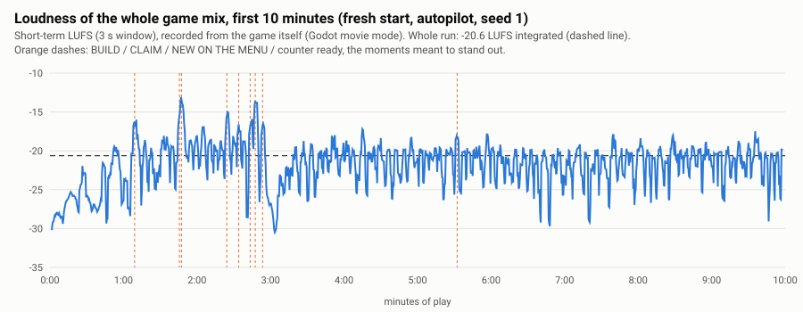

# Dhaba Rush: sound and music

Sprint 2026-10-26 · sound track · 0.3.6. **Updated 2 Nov 2026 for the core-and-feel build:** three new world sounds (the night TV, the baraat band, the sitting dog; section 3, "World sounds"), listening points 21–24 (section 2), and the `angry` sound is no longer heard (nobody gives up and leaves, C2.1).

Nothing was committed, exported, installed or uploaded. Every Godot run used a scratch copy with its own HOME; the real save is unchanged (md5 `0df78beb11133c66873437f0b54b2108`). No agent can hear: everything below was measured (loudness, spectrograms, recordings of the game's own output), and section 2 is the list of things only your ears can judge.

**In short**

- **Music:** a new 68.6 s loop (was 10.4 s and repeated 6 times a minute). Harmonium chords over a soft Sa drone, tabla in keherwa, a bansuri melody, santoor in the middle section. Key of D, 84 bpm, 24 bars in three sections, so it does not feel like a loop for over a minute. The loop point is seamless by construction. In the game it fades in over 2.5 s, dips 3 dB while Munshi-ji's box is open, and at night it is 4 dB quieter and darker (a low-pass).
- **Ambience (new):** a faint bed under everything. By day: the highway far off, a few lorries passing, sparrows. At night: crickets and a distant lorry. It crossfades with the day / night cycle.
- **No more repetition fatigue:** the sale has 3 versions (cash box, coins, two bells), the serve 3, the bill whoosh 2; Sfx never plays the same one twice in a row. Horns are now 4 different vehicles: car, a lorry's two-note air horn (more often at night), an auto's bulb horn, a bike.
- **Stalls:** new chai pour and tandoor slap (need a one-line hook, section 7); lassi churn, kadai sizzle, egg crack and handi bubbles redone.
- **UI:** the deny is a soft muted "bup-bup", no longer a square-wave buzzer; tap, confirm and Munshi-ji's typing (now a pen tick) redone; the BUILD sound is now a small unlock fanfare (dholak, harmonium, santoor run).
- **Mix:** three buses (Music, SFX, UI), a limiter on Master, SOUND OFF silences at once (tails and ambience too). Every sound sits at a set loudness (section 3). The game is louder than before, the music most (it was very quiet: +6 dB), the sale +5 dB, horns +1 dB; the first 10 minutes measure −20.6 LUFS.
- **Size:** audio in the APK goes from 0.21 MB to 0.61 MB (+0.40 MB; release APK about 83.3 MB, download about +0.4 MB, roughly +1 %).
- **Retired:** `coin`, `rush`, `sizzle` (never played) and the old `music_loop.wav` moved to `tools/audio/retired/` (not exported, not imported).

---

## 1. Listen first

Four MP3s in [`docs/polish/audio/`](audio/), made from the real files at their in-game levels. Best on your phone's own speaker and then on earphones.

| File | What it is | Length |
|---|---|---|
| `first_3_minutes.mp3` | The game itself: a fresh start, the tutorial on autopilot, recorded from Godot's own audio output (movie mode). This is what a new player hears. | 3:00 |
| `night.mp3` | Free play at night with the tandoor and the lassi built (music darker and quieter, crickets, the lassi churn). The first seconds are the debug BUILDs. | 1:40 |
| `music_twice.mp3` | The music loop twice, then 20 s of the day bed and 20 s of the night bed alone. The loop point is at 1:08.6. | 3:01 |
| `sfx_reel.mp3` | Every sound once, 1 s apart, at its in-game level, in the order of the table in section 3. | 0:51 |

## 2. Listening checklist

Tick each line or write what is wrong next to it. Every fix is one number in `tools/audio/make_sfx.py` (the sound) or `scripts/autoload/sfx.gd` (its level); section 6 says where.

**On the phone, game running (the real test)**

1. **Start the game with the phone at your normal volume.** Does the music fade in gently, or does it start too loud / too quiet next to other apps (YouTube, WhatsApp voice notes)? Whole-mix loudness is about −20 LUFS; most video apps are around −14, so the game is calmer than a video. If it is too quiet overall, raise all three `BUS_DB` values in `sfx.gd` by the same amount.
2. **First minute (Munshi-ji's intro).** Can you hear his typing ticks without them being annoying? Is the music still present under his box (it dips 3 dB)?
3. **First sale (0:44 in `first_3_minutes.mp3`).** Does the cash-box clack + coins + two bells say "money came in"? Is it pleasant the 50th time? Listen to a few sales in a row: you should not notice that they repeat.
4. **The serve (a dish lands on a table, about 15 a minute).** It should be a soft plate-on-wood tok with a small steel ring and a tiny ting, quieter than the sale. Too clicky? Too bright?
5. **The waiter's pickup pop.** The most frequent sound (up to 22 a minute). Now about 2.5 dB under the serve. Should it be even quieter, or gone?
6. **LEVEL UP (0:51 to 0:57).** Tap fast and hold: the knock climbs in pitch (feel track's combo). Does it stay satisfying, not tiring, after 20 taps?
7. **CLAIM (1:09) and the count-up ticks after it.** Rewarding, not shrill?
8. **BUILD a table (1:47) and BUILD in the build list (2:47).** The unlock fanfare: two dholak hits, a harmonium chord, a santoor run up. Does it feel like a small celebration? Too long (it rings for about 2 s)?
9. **A grey button (can't afford).** The deny: two soft, muted falling notes. Clear enough that it means "no", but not a buzzer?
10. **Horns (about 3 a minute, never closer than 10 s).** Do they read as Indian highway traffic: the car's double "peep-peep", the lorry's two-note air horn, the auto's bulb horn "paw-paw", the bike's thin beep? Does any of them make you jump? (They are pushed back with a little distance and room.)
11. **The ambience.** By day, with the music off (Settings > MUSIC): is the far highway and sparrows nice, or does it sound like hiss? At night: are the crickets pleasant or tinnitus-like?
12. **Night (wait for dusk in free play, or `night.mp3`).** Does the music feel like it has gone sleepy and warm, not muffled-broken?
13. **Lassi churn / kadai sizzle / egg / dal bubbles** (once those counters are built and on screen). Each one should be recognisable as its stall. On the phone speaker the dal bubbles are the weakest.
14. **Settings.** MUSIC OFF stops the music at once; SOUND OFF silences everything else at once (ambience too) and keeps the music; switching SOUND back on plays a tap. Vibration is the feel track's.
15. **Background.** Press home mid-sale: silence at once. Come back: sound fades back in (0.35 s, Main3). Pull down the notification shade: silent while it is down. Watch an ad (test ad): the game is silent under the ad.
16. **Earphones.** The music is stereo (two harmonium reeds left / right, the santoor a little right, the bansuri a little left); everything else is mono. Nothing should feel lopsided.

**The music alone (`music_twice.mp3`)**

17. Warm and light, or busy? The bansuri and the tabla are on top; the harmonium should sit behind them.
18. Is the bansuri in tune and does its bending sound like a flute, not a theremin?
19. At 1:08.6 (the loop point): can you hear any jump, click or change of mood? You should not.
20. After 10 minutes of it (play the file on repeat while you work): still OK, or does one phrase start to grate? Name the phrase (time in the file) and it can be rewritten.

**The reel (`sfx_reel.mp3`)**: does anything sound wrong for what it is (a lorry that sounds like a goose, a sizzle that sounds like rain)? The table in section 3 says what each one is meant to be.

**Core-and-feel sounds (on the phone build; not in the MP3s above, which predate them)**

21. **The night TV** (`tv_cheer`). At night, every 40–90 s, a quiet cricket crowd from the small TV on the left wall. It should sit far back, under the music, like a TV across the room. Too present? Does it ever sound like a real broadcast you recognise? It should not.
22. **The baraat band** (`baraat_band`). On a Saturday or Sunday, after 10 minutes of free play, when the decorated bus drops its guests: a dhol chaal and a trumpet rising to a held note, in the music's key. Festive, or too loud next to the sale chime? It plays at most once per bus (a bus every 120 s at most).
23. **The dog** (`dog_bark`). Two short barks a little way off, as a vehicle that does not stop (the dhaba had no room for its riders) passes the gate, so you see it go by (at most once every 45 s). Does it read as "a lorry just drove past", or is it annoying when the dhaba is full for a while?
24. **C8.5: the music on a phone.** Points 1, 12 and 17–20 again, on the phone speaker and on earphones. Nobody has heard the music on a phone yet; it was synthesised and only measured.

## 3. Every sound

"Loud" is the loudness in the game: LUFS after Sfx's volume and the bus level (the loudest 400 ms for a one-shot, the whole loop for the beds). Higher is louder; 6 dB is about twice as loud. "Phone" is how much a small phone speaker takes away (bass it cannot play); everything is under 5 dB, so the mix holds on a phone. Files are 22 050 Hz mono 16-bit `.wav` (Godot imports them as QOA) unless noted.


### Beds

| Id | Plays | Meant to sound like | Length | Loud | Phone |
|---|---|---|---|---|---|
| `music_loop` (.ogg, stereo) | always, unless MUSIC is off. Fades in 2.5 s; −3 dB while Munshi-ji's box is open; at night −4 dB and a low-pass sliding to 4.5 kHz | a warm, unhurried dhaba radio: harmonium, tabla, bansuri, santoor (section 5) | 68.57 s loop | −27 | 1.6 |
| `amb_day` (.ogg) | by day, under everything (SFX bus, stops with SOUND OFF) | the highway a few hundred metres away, a lorry passing now and then, sparrows | 16 s loop | −39 | ~0 |
| `amb_night` (.ogg) | at night (crossfades with the cycle) | two crickets, a lorry far away | 16 s loop | −37 | ~0 |

### Core loop

| Id | Plays when (code) | Meant to sound like | Length | Loud | Phone |
|---|---|---|---|---|---|
| `sale_chime` ×3 | a bill is paid at the galla (`galla_node.gd` and `Fx.cash_burst` in the same frame; Sfx's cooldown keeps it to one) | wooden cash box clack, 2–3 coins, two small brass bells (E6→B6, D6→A6, E6→A6) | 0.67 s | −18 | ~0 |
| `bill_whoosh` ×2 | the banknotes fly to the money pill (`Fx.cash_burst`) | papery flutter | 0.30–0.34 s | −26 | ~0 |
| `serve` ×3 | each dish lands on a table (`waiter.gd`) | steel thali set on wood: low tok, short steel ring, tiny ting (E7 / D7 / F#7) | 0.40 s | −20.5 | ~0 |
| `pop` (pitched) | a waiter lifts a dish off the pass (`waiter.gd`, one steady pitch per waiter) | small bubbly blip | 0.10 s | −23 | 2.5 |
| `pop` | a new counter appears, a hire pops in (feel track), popups open | same blip, louder | 0.10 s | −19 | 2.5 |

### Traffic

`traffic.gd` calls `Sfx.play("horn")` (a vehicle passing the honk point, a lorry or bus leaving; never closer than 10 s). Sfx picks one of four, weighted 5 : 3 : 2 : 2, and the lorry gets up to 2.5× likelier at night.

| Id | Meant to sound like | Length | Loud |
|---|---|---|---|
| `horn` | a car's electric double honk "peep-peep" | 0.85 s | −22 |
| `horn_truck` | a lorry's two-note air horn (A+C# then F#+A), the "HORN OK PLEASE" one | 1.64 s | −21 |
| `horn_auto` | an autorickshaw's rubber bulb horn, two squeezes | 0.76 s | −23 |
| `bike` | a scooter's thin double beep | 0.66 s | −23.5 |

### Stalls (a cook starts an order and the counter is on screen; `station_node.gd` `COOK_SOUND`)

| Id | Stall | Meant to sound like | Length | Loud | Phone |
|---|---|---|---|---|---|
| `chai_pour` | chai (**hook needed**, section 7) | chai pulled into a glass: a bubbly stream rising in pitch as it fills, a glass tink | 0.92 s | −26 | ~0 |
| `tandoor_slap` | tandoor (**hook needed**) | roti dough slapped on the tandoor wall, a soft fire whoosh, a few crackles | 0.54 s | −26 | 2.5 |
| `churn` | lassi | the wooden madhani swishing twice in a clay pot, knocking the side | 0.48 s | −26 | 1.8 |
| `kadai_sizzle` | kadai paneer | hot oil sizzle and crackle, the steel karchhi clinking the kadai | 0.66 s | −26 | ~0 |
| `egg_crack` | bhurji | a shell cracking, then a quick sizzle on the tawa | 0.51 s | −26 | ~0 |
| `handi_bubble` | dal makhani, chole | thick dal blubbing in a handi, three bubbles | 0.55 s | −26 | 4.9 |

### UI and moments

| Id | Plays when (code) | Meant to sound like | Length | Loud |
|---|---|---|---|---|
| `tap` | light taps: NEXT chip, sheets and panels opening, Settings rows | a tiny wooden tick | 0.06 s | −27 |
| `button_thunk` | most button presses (`UiButton`; skipped right after a LEVEL UP knock, feel track) | a soft wood block | 0.16 s | −21 |
| `deny` (pitched) | a tap on a grey button (`UiButton.deny`) | two muted notes falling, A4 then F#4 | 0.41 s | −21 |
| `typewriter` | Munshi-ji's text types (every second letter) | a pen nib ticking on the ledger | 0.04 s | −37 |
| `marker_pop` | the tutorial marker; the NEXT chip's first reveal | an upward bubble and a glint | 0.25 s | −19 |
| `reward_count` (pitched) | the reward count-up ticks, rising | a small bell tick | 0.17 s | −23 |
| `upgrade` (pitched) | LEVEL UP / SPEED, climbing a scale while you keep tapping (feel track, `world_juice.gd`) | a woody tok and an A6 ting | 0.33 s | −21 |
| `claim` | CLAIM a task, open the chest, a reward burst | an airy rise and a sparkling D major chord | 0.96 s | −14 |
| `build_done` | BUILD a counter or a table (`Fx.build_fx`, the BUILD buttons) | the unlock fanfare: dholak "dha-dhin", a harmonium D chord swelling, a santoor run up, a shimmer | 2.05 s | −12 |
| `menu_unlock` | NEW ON THE MENU (L25 / L50 / L100) | three rising bells over a soft harmonium chord | 0.96 s | −13 |
| `ready` | a counter becomes affordable to build (first time each session) | two soft bells, A5 then D6 | 0.66 s | −17 |
| `angry` | a traveller gives up and leaves, only after 20 s without another give-up (feel track, `world_juice.gd`) | a soft falling "hm-mm" on a muted reed, not a buzzer | 0.40 s | −24 |

### World sounds (core and feel, 2 Nov 2026)

All three are on the SFX bus (SOUND OFF silences them), 22 050 Hz mono 16-bit `.wav`, made by `tools/audio/make_sfx.py` like the rest. "Loud" is the target in the game (LUFS-M max of the file + `VOLUME_DB` + the 3 dB bus); `measure.py` measured the files at −17.4, −11.5 and −17.1 LUFS-M max.

| Id | Plays when (code) | Meant to sound like | Length | Loud | Cooldown | `VOLUME_DB` |
|---|---|---|---|---|---|---|
| `tv_cheer` | at night only, while the TV on the left wall is on: every 40–90 s, a random gap from the TV's own random generator (`scripts/v3/world/tv_node.gd`, `CHEER_GAP`) | a cricket crowd swelling out of a small TV across the room: voices, claps, a tinny speaker | 1.69 s | −30 (quiet, distant) | 30 s | −15.6 |
| `baraat_band` | a decorated baraat bus drops one or more wedding guests at the stop (weekend baraat, C6.4; `scripts/v3/world/sim.gd`); a bus that drives past because the seats are full plays nothing | a dhol bhangra chaal and a trumpet sting rising up the D major chord to a held D6 (pitch jitter 0, so it stays in key) | 2.99 s | −19 | 20 s | −10.5 |
| `dog_bark` | the sitting dog by the dhaba barks when a vehicle that drives past for want of room reaches the gate, on screen at home (C2.1 drive-past; `scripts/v3/world/traffic.gd` `_tick_drive` → `_dog_bark()`, at most once every 45 s, `DOG_BARK_GAP`; since 3 Nov at the gate, not when the vehicle is sent off screen) | two short barks a little way off | 0.71 s | −24 | 20 s | −9.9 |

The levels are set in `scripts/autoload/sfx.gd` (`BUS_OF`, `COOLDOWN`, `VOLUME_DB`, `PITCH_JITTER_MAX`). `tools/audio/measure.py` does not list them in `TARGETS` yet; add `"tv_cheer": -30.0, "baraat_band": -19.0, "dog_bark": -24.0` there so `--suggest` agrees (the final QA step of the core-and-feel build owns that file). Their `.import` files appear when the project is next opened in the Godot editor (owner task; keep `compress/mode=2`, QOA).

`angry` (section "UI and moments") still exists and is still wired to a traveller giving up, but in this build nobody gives up (`seating.give_up_s` 0, C2.1), so it is never heard.

All tonal sounds use notes of D major, the music's key, and Sfx limits their random pitch change (`PITCH_JITTER_MAX`: chimes ±1.2 %, fanfares 0) so they stay in tune with it.

## 4. The mix

```
Master  (hard limiter, ceiling −0.8 dB; volume = Main3 background silence; mute = Ads during an ad)
├── Music  +3 dB   music_loop                    duck −3 dB (Munshi-ji), night −4 dB + low-pass
├── SFX    +3 dB   world sounds, ambience        muted by SOUND OFF
└── UI     +3 dB   taps, buttons, rewards        muted by SOUND OFF
```

- **Where it lives:** `scripts/autoload/sfx.gd`. The buses are created there at start (the project has no `default_bus_layout.tres`; Master stays bus 0, so Main3 and Ads work as before). `BUS_DB` is the three owner knobs; `VOLUME_DB` and `PITCHED_DB` are each sound's level inside its bus, set from measurements so every sound lands on the loudness in section 3.
- **Ducking:** Sfx reads `Refs.dialogue.is_open()` every frame: −3 dB in 0.35 s, back in 1.2 s. No hook needed.
- **Night:** Sfx reads `Refs.sim.night_f` (set by DayNight; 0 in the tutorial), smoothed over ~3 s: music −4 dB and a low-pass from 16 kHz down to 4.5 kHz (the filter is switched off by day, so it costs nothing then); ambience crossfades; the lorry horn gets likelier.
- **Variants:** `VARIANTS` in Sfx. A random pick, weighted, never the same file twice in a row.
- **Voices:** 10 one-shot players (was 8); a new sound takes a free player first, and only steals the oldest when all 10 are busy. In the first 10 minutes no more than 4 one-shots overlapped (plus the music and the ambience).
- **Limiter:** the loudest moment of the first 10 minutes peaks at −0.8 dBFS (the ceiling) and nothing clips.
- **SOUND OFF / MUSIC OFF:** SOUND OFF mutes the SFX and UI buses at once (a sale chime that is ringing stops too) and stops the ambience; MUSIC OFF stops the music; both saved in `user://settings.json` as before. Tested in a scratch run (70 checks, 0 failed: buses, limiter, loop lengths and flags, every id loads, routing and levels, variants, SOUND / MUSIC toggles and saving, ducking, night filter and level, ambience crossfade, horn weights by night, Master volume left to Main3).
- **Background:** unchanged and still Main3's (`set_app_audio`: Master to −80 dB on pause and on focus loss on a phone, 0.35 s fade back). Ads still mute Master during an ad.



What the timeline shows: the first minute is calm (music under Munshi-ji's lines, about −28 LUFS); from the first sale the dhaba settles around −21 with sales (12–15 a minute), serves (12–15), pickups (13–22) and horns (about 3); BUILD and CLAIM stand out by 5–7 dB, as rewards should. The same run, seed and autopilot gave the timings in section 2.

## 5. The music

- **Form:** 84 bpm, 4/4, 24 bars = 68.57 s (an exact 1 512 000 samples). Section A (bars 1–8): bansuri call and answer. Section B (9–16): santoor broken chords, then a higher bansuri line. Section C (17–24): the tabla thins out (sam, a soft na, dhi) with santoor "raindrops", then a lower bansuri phrase and a tirakita fill into the top of the loop.
- **Chords:** D D G D | C G A D | G G D D | Em A D D | D C G D | G C A A7. The C natural is Khamaj colour (komal ni), common in light folk music.
- **Instruments, all synthesised:** harmonium (two reed banks a few cents apart, left and right, so they beat slowly; a nasal formant near 1.1 kHz; bellows swell per bar), a quiet Sa–Pa drone, tabla (dayan tuned to Sa = D4, bayan with the palm's upward bend on "ge"; keherwa theka dha ge na ti | na ka dhi na with a light swing), bansuri (breath, delayed vibrato, glides between joined notes), santoor (two strings per note, slightly stiff). One shared noise reverb (1.6 s).
- **Seamless by construction:** every note is placed modulo the loop length (a note that crosses the end continues at the start), the drone's frequencies are snapped to whole cycles per loop, and the reverb is a circular convolution, so its tail wraps into the start. Measured after Ogg encoding: the jump across the loop point is smaller than the music's ordinary sample-to-sample movement (0.34× its 99th percentile).
- **Format:** Ogg Vorbis, 22 050 Hz stereo, about 34 kbps (291 KB). Imports as a looping stream (`loop=true` in its `.import`; Sfx also sets it at start).
- **Balance** (`STEM_DB` in `make_sfx.py`, RMS over the loop): bansuri and tabla on top, harmonium 4 dB behind, santoor 3.5 dB behind, drone well under.

## 6. How to change something

All sounds come from `tools/audio/make_sfx.py`. Each has its own random generator seeded by its name, so changing one leaves every other file byte-identical (the Ogg files differ in bytes on every run because of Ogg's random stream serial; their decoded audio is identical).

```
# regenerate everything (Blender's Python has numpy; its aud module encodes Ogg)
/Applications/Blender.app/Contents/MacOS/Blender -b --factory-startup --python tools/audio/make_sfx.py -- assets/audio
# just some (plain Python with numpy is enough for .wav)
/Applications/Blender.app/Contents/Resources/5.2/python/bin/python3.13 -I tools/audio/make_sfx.py assets/audio --only deny,serve
# measure: length, peak, LUFS, loudness in game, phone-speaker loss, clipping, edge clicks, loop seams;
# --suggest prints the VOLUME_DB / PITCHED_DB that put each sound on its target (TARGETS in measure.py)
/Applications/Blender.app/Contents/MacOS/Blender -b --factory-startup --python tools/audio/measure.py -- assets/audio --suggest
# see a sound (level strip + spectrogram PNG), or several stacked
python3.13 tools/audio/spectro.py assets/audio/serve.wav /tmp/serve.png
python3.13 tools/audio/spectro.py --sheet /tmp/sheet.png assets/audio/serve*.wav
# rebuild the listening MP3s
/Applications/Blender.app/Contents/MacOS/Blender -b --factory-startup --python tools/audio/preview.py -- assets/audio docs/polish/audio
```

| You hear | Change |
|---|---|
| a sound too loud / quiet | its number in `VOLUME_DB` (or `PITCHED_DB`) in `sfx.gd`; 3 dB is a clear step. Then update its target in `TARGETS` (`measure.py`) so `--suggest` agrees |
| everything too loud / quiet | the three `BUS_DB` values in `sfx.gd`, by the same amount |
| music too present | `"music_loop"` in `VOLUME_DB`; under Munshi-ji `DUCK_DB`; at night `NIGHT_MUSIC_DB`, `NIGHT_LPF_HZ` |
| the music's balance (tabla too busy, pad too thick) | `STEM_DB` in `make_sfx.py`, then regenerate |
| a melody phrase grates | `PHRASE_A` / `PHRASE_A2` / `PHRASE_B` / `PHRASE_C` (MIDI note, beat, length) |
| ambience unwanted | `"amb_day"` / `"amb_night"` in `VOLUME_DB` (−80 silences it) |
| horn mix | `VARIANTS["horn"]` weights, and the night factor in `_variant_weight()` |
| one variant sounds off | remove it from `VARIANTS` (the file can stay) |

New `.wav` files need their `.import` (Godot writes it on the next editor open; keep `compress/mode=2`, QOA). New `.ogg` files need `loop=true` in theirs for a bed.

## 7. Hooks for other tracks (not done here: outside this track's files)

1. **Chai and tandoor sounds** (`scripts/v3/world/station_node.gd`, `COOK_SOUND`): add `"chai": "chai_pour", "tandoor": "tandoor_slap"`. These are the two counters of the first 10 minutes; today no stall makes a sound until the lassi is built. Sfx already has their cooldowns (1.5 s, 1.2 s) and levels, and `_cook_sound()` already plays only when the counter is on screen.
2. **Horn by vehicle** (`scripts/v3/world/traffic.gd`, `_horn(c)`): optional. Today Sfx picks the horn at random. To match the vehicle: `Sfx.play({K_TRUCK: "horn_truck", K_BUS: "horn_truck", K_AUTO: "horn_auto", K_BIKE: "bike"}.get(c.kind, "horn"))`. Levels are per file, so nothing else changes.
3. **Dead code** (`scripts/v3/main3.gd`, `_loop_music()` and `MUSIC_PATH`): `music_loop.wav` is retired, so `_loop_music()` returns at once. It can go.
4. **LEVEL UP double knock** (feel track, `world_juice.gd` / `sfx.gd` `COVERS`): in the seed-1 autopilot run, at 1:55 and 2:19, `button_thunk` was played in the same frame just before `upgrade`, so the cover (which only skips a knock that comes after) did not apply. Worth a look if those taps sound doubled.
5. **Docs** (`docs/optimise/report.md` size table, `docs/launch/release.md` if it quotes sizes): audio is now 0.61 MB in the APK (was 0.21).

## 8. Numbers

| | Before | After |
|---|---|---|
| Sound files | 25 `.wav` + 10.4 s music `.wav` (19 played) | 31 `.wav` + 3 `.ogg` (all played except `chai_pour`, `tandoor_slap` until hooked); core and feel (2 Nov 2026): 34 `.wav` (+ `tv_cheer`, `baraat_band`, `dog_bark`), and `angry` is no longer heard |
| Music | 10.43 s mono, repeats ~6× a minute; its last quarter-second was 6.7 dB quieter than its first, a dip at every repeat | 68.57 s stereo, seamless |
| In the APK (imported, as packed) | 212 766 B | 609 228 B (SFX QOA 172 697 B, Ogg 436 531 B) |
| Whole mix, first 10 min (seed 1, autopilot) | not measured | −20.6 LUFS integrated, peak −0.8 dBFS (limiter), 0 clipped samples |
| Night free play (100 s, tandoor + lassi built) | | −21.5 LUFS |
| Music alone in the game | −32.9 LUFS | −27.0 LUFS (−30 under Munshi-ji, −31 at night) |

APK impact is from the imported files, which go into the PCK as they are (QOA and Ogg barely zip): about +0.4 MB on the 82.9 MB release APK and on the 33.7 MB download. No APK was built.

Known and harmless: quitting while the music and ambience play can print "N resources still in use at exit" (Ogg playbacks the audio thread had not yet released; timing dependent, gone with `--verbose`). It is exit-only and never seen on a phone.

## 9. Files

- `tools/audio/make_sfx.py`: the generator (rewritten: per-sound seeds, music, ambience, Ogg encoding).
- `tools/audio/measure.py` (new): loudness, phone loss, clipping, seams, mix targets and `--suggest`.
- `tools/audio/spectro.py` (new): PNG level strip + spectrogram, `--loop` seam view, `--sheet`.
- `tools/audio/preview.py` (new): the listening MP3s.
- `tools/audio/retired/` (new, `.gdignore`): `coin`, `rush`, `sizzle`, the old `music_loop.wav`, with their `.import`.
- `assets/audio/`: 31 `.wav` (22 regenerated, 9 new) and 3 `.ogg` (new), with `.import` files.
- `scripts/autoload/sfx.gd`: buses, limiter, levels, variants, ducking, night, ambience, pitch caps, voice allocation. The feel track's additions in the same file (the LEVEL UP cover, `buzz()` to Haptics) are theirs.
- `docs/polish/audio.md` (this file), `docs/polish/audio/` (two charts, four MP3s).
