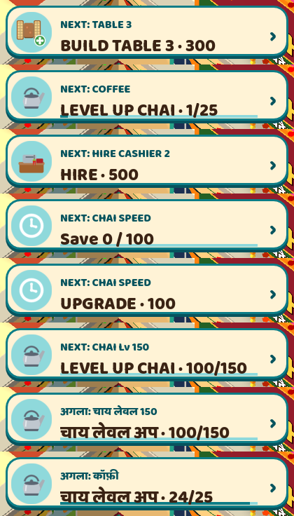

# Dhaba Rush soft launch: game polish

0.3.6 + soft launch polish · 2026-10-25 · game polish track.

Nothing was committed, exported, installed or uploaded. Every Godot run used a scratch copy with its own HOME and user dir; the real save is unchanged (md5 `0df78beb11133c66873437f0b54b2108`).

**In short**
- **NEXT chip:** once every counter is built (after the kadai) it still names a goal: the next table, a hire, the next dish (L25 / L50 / L100), a SPEED upgrade or the next level milestone. It hides only when everything is maxed.
- **Plain English:** task cards and BUILD texts lose the idioms and Hindi words ("Slap 20 rotis" → "Bake 20 rotis in the tandoor", "annex bhatti" → "back kitchen"). The Hindi follows.
- **Audio:** all 25 sound files and the music checked, by level and by when they play (19 in use, 6 never played). The waiter's pickup pop and the deny buzz are 4 dB quieter, horns are spaced at least 10 s apart, the music loops without a gap, and the game goes silent in the background. Settings MUSIC / SOUND work (tested).
- **Analytics:** the funnel events the soft launch needs: tutorial beats in order with timing, first purchase attempt and success, ad offers and closes per placement, session settings and end, offline return, settings changes, level milestones. Event list and funnels: [analytics.md](analytics.md).
- **Unchanged:** tutorial (English and Hindi), 600 s of free play (identical numbers on 4 seeds), tap check, zoom test, SDK self-test.

---

## 1. NEXT chip: always a goal

Before: after the kadai, `Game.next_build_id()` is empty and the chip disappeared for good (unless a PROBLEM showed).

Now, with every counter built, the chip picks from a ladder (`scripts/v3/ui/next_chip.gd`, `_endless()`):

| Order | Goal | Chip (English) | Tap opens | Hand on |
|---|---|---|---|---|
| 1 | Next table set (until 5) | NEXT: TABLE 4 · BUILD TABLE 4 · 1,800, or Save 900 / 1,800 | ghost table card, else BUILD › TABLES | BUILD |
| 2 | A hire, when it is affordable now (the STAFF badge's own pick, `Game.best_hire()`) | NEXT: HIRE WAITER 4 · HIRE · 1,200; NEXT: HIRE COOK · TANDOOR · 2,500 | STAFF on that tab | HIRE |
| 3 | The nearest dish still locked (menus open at L25, L50, L100) | NEXT: DAL MAKHANI · LEVEL UP KADAI · 18/25 (with a progress bar) | that counter's sheet | LEVEL UP |
| 4 | The same hire, not affordable yet | NEXT: HIRE COOK · Save 900 / 2,500 | STAFF | HIRE |
| 5 | The cheapest SPEED upgrade left | NEXT: CHAI SPEED · UPGRADE · 800 | the counter's sheet | SPEED |
| 6 | The next level milestone of the lowest counter (150, 200, 250, 300) | NEXT: CHAI Lv 150 · LEVEL UP CHAI · 100/150 | the counter's sheet | LEVEL UP |

- PROBLEM chips (seats full, food waiting, long bill line) still come first, as before.
- A goal stays up at least 15 s while it is still valid, so the chip does not flip between two goals as cash goes up and down.
- The coach hand shows for the first two taps of each goal kind, like the other chip goals.
- The one-tag rule follows: the table goal shows the ghost table's tag, a waiter hire the ghost waiter's tag.
- Hindi uses the existing words (अगला:, टेबल, रखें, अपग्रेड, स्पीड, लेवल) plus one new line, `{name} लेवल अप · {lv}/{target}`.

## 2. Plain English texts

`data/economy_v3.json`, `i18n/hi.po` (and the template `i18n/dhaba_rush.pot`).

| Where | Before | Now | Hindi now |
|---|---|---|---|
| Task: tandoor | Slap {n} rotis into the tandoor | Bake {n} rotis in the tandoor | तंदूर में {n} रोटियाँ सेंकें |
| Task: naan | Slap {n} naans onto the clay | Bake {n} naans in the tandoor | तंदूर में {n} नान सेंकें |
| Task: keema paratha | Stuff {n} keema parathas | Bake {n} keema parathas | {n} कीमा पराठे सेंकें |
| Task: kulcha | Crisp {n} Amritsari kulchas | Bake {n} Amritsari kulchas | {n} अमृतसरी कुलचे सेंकें (kept) |
| Task: kesar doodh | Warm {n} kulhads of kesar doodh | Serve {n} cups of kesar doodh | {n} कुल्हड़ केसर दूध परोसें |
| Task: coffee | Pour {n} tumblers of coffee | Pour {n} cups of coffee | {n} कप कॉफ़ी डालें |
| Task: lassi | Churn {n} glasses of lassi | Make {n} glasses of lassi | {n} गिलास लस्सी बनाएँ |
| Task: Patiala lassi | Fill {n} Patiala glasses | Serve {n} glasses of Patiala lassi | {n} गिलास पटियाला लस्सी परोसें |
| Task: dal makhani | Ladle out {n} bowls of dal makhani | Serve {n} bowls of dal makhani | (kept) |
| Task: kadai paneer | Toss {n} plates of kadai paneer | Cook {n} plates of kadai paneer | (kept) |
| BUILD: kadai | One iron kadai on the annex bhatti. Bhurji today; dal, paneer and chole to follow. | A big iron kadai in the back kitchen. Egg bhurji first, then dal, paneer and chole. | पीछे की रसोई में एक बड़ी कड़ाही। पहले अंडा भुर्जी, फिर दाल, पनीर और छोले। |
| BUILD: lassi | …churned in a clay matka, with a lid of malai on top. | …from a clay pot, with a layer of cream on top. | (kept) |
| Menu: coffee | Filter kaapi in a steel tumbler… | Filter coffee in a steel tumbler… | (kept) |
| Menu: kesar doodh | …in a kulhad, pista on top… | …in a clay cup, pistachios on top… | (kept) |
| Menu: chaas | …roasted jeera… | …roasted cumin… | (kept) |
| Menu: dal makhani | …The karchhi has seen things. | …The ladle has seen things. | (kept) |

Dish and counter names stay as they are on the menu (chai, roti, kadai paneer, kesar doodh). The two unused `info` texts for waiters and seating were made plain too. Other task texts were already plain. `tools/i18n/check_po.py`: 348 msgids, 0 missing. **For the native-speaker review:** the 7 Hindi lines marked above as new.

## 3. Audio pass

### 3.1 Every sound

Files are 22 050 Hz mono 16-bit (`assets/audio/`, made by `tools/audio/make_sfx.py`). Peak and RMS (of the sounding part) are the file's; "Sfx" is the volume `scripts/autoload/sfx.gd` plays it at; "Loud" is the loudest 400 ms window after that volume, the simplest fair measure of how loud a short sound seems in the mix. Rates per minute of play, with Sfx's cooldowns applied in game time (as on a phone at normal speed): the tutorial from the autopilot (seed 1), free play from 10 minutes at the home view (2 cashiers, 2 waiters, 3 tables, chai, tandoor and lassi). A bigger dhaba plays the sale and serve sounds more often.

| Sound | Plays when | Length (s) | Peak (dBFS) | RMS (dBFS) | Sfx (dB) | Loud (dB) | Tutorial /min | Free play /min |
|---|---|---|---|---|---|---|---|---|
| music_loop | background music, looped | 10.43 | −4.4 | −19.2 | −13 | −29.7 | always | always |
| sale_chime | a bill is paid at the cash counter (once per sale) | 0.65 | −5.2 | −20.1 | −7 | −25.0 | 9.4 | 10.7 |
| bill_whoosh | the bills fly to the money pill (each sale) | 0.34 | −6.9 | −21.1 | −11 | −33.4 | 9.4 | 10.7 |
| serve | each dish lands on a table | 0.45 | −6.9 | −20.1 | −6 | −26.1 | 9.4 | 22.4 |
| pop (pickup) | a waiter lifts a dish off the pass; **now only on screen** | 0.09 | −4.4 | −11.6 | **−4** (was 0) | **−24.2** (was −20.2) | 8.7 | 22.6 |
| pop (other) | a new counter appears; the 2-tap card and popups open | 0.09 | −4.4 | −11.6 | 0 | −20.2 | rare | rare |
| horn | a passing vehicle; a lorry or bus leaving; **now at most one per 10 s** | 0.75 | −6.0 | −15.1 | −8 | −22.6 | 1.7 | **2.5** (was 3.6) |
| churn / egg_crack / handi_bubble / kadai_sizzle | a lassi or kadai cook starts an order, counter on screen | 0.5–0.6 | −6.0 to −8.0 | −18.7 to −24.5 | −11, −12 | −29.7 to −35.5 | 0 | 6.3 (churn) |
| typewriter | Munshi-ji's text types (every second letter) | 0.05 | −9.1 | −22.0 | −15 | −46.0 | 147 while a line types | 1.9 |
| button_thunk | most button presses (LEVEL UP, HIRE, UPGRADE and the like) | 0.20 | −3.1 | −15.9 | −4 | −24.1 | 8.7 | per tap |
| tap | light taps: NEXT chip, sheets and panels opening, Settings rows, tabs | 0.08 | −6.0 | −19.8 | −6 | −34.9 | 2.4 | per tap |
| deny | a tap on a grey (unaffordable or maxed) button | 0.30 | −6.9 | −16.3 | **−4** (was 0) | **−21.6** (was −17.6) | 0 | per tap |
| claim | CLAIM a task, open the chest, a reward burst | 0.85 | −3.7 | −18.3 | −3 | −19.0 | 1.7 | per claim |
| reward_count | the reward count-up ticks (rising pitch) | 0.16 | −8.0 | −19.9 | −4 | −28.1 | 13.6 | per reward |
| build_done | BUILD a counter or a table | 1.10 | −2.5 | −16.4 | −2 | −15.2 | 0.7 | per build |
| ready | a counter becomes affordable to build (first time for each) | 0.50 | −5.2 | −17.9 | 0 | −17.0 | 0 | rare |
| menu_unlock | NEW ON THE MENU (L25, L50, L100) | 0.75 | −4.4 | −18.2 | −4 | −19.6 | 0 | rare |
| marker_pop | the tutorial marker; the NEXT chip's first reveal | 0.25 | −4.4 | −16.7 | −5 | −23.7 | 2.1 | rare |
| angry, bike, coin, rush, sizzle, upgrade | never played | 0.35–1.0 | | | | | 0 | 0 |

**Reading it:** the sale (chime + whoosh, about 11 a minute) and the dishes landing (serve, about 22 a minute) are the core loop, between −25 and −33 dB loud; the music sits about 5 dB under them. Before this pass the waiter's pickup pop was the most frequent sound with serve and the loudest of the frequent ones (−20 dB, 5 dB over the sale chime), the horn came every 12 s on average and sometimes 3 s apart, and a grey LEVEL UP's deny buzz was louder than CLAIM.

### 3.2 What changed

| Change | File | Why |
|---|---|---|
| The waiter's pickup pop plays 4 dB quieter (Sfx `play_pitched`), with a steady pitch per waiter, and only while the waiter is on screen | `world/waiter.gd` | The most frequent and loudest repeating sound. Now −24 dB, level with the sale chime (−25). At the home view every pickup is on screen, so the 4 dB is what you hear; scrolled away (parking, kitchen) the pickups go quiet, like the cooks' sounds already did. |
| Horns at most one every 10 s | `world/traffic.gd` (`_horn`) | The horn is louder than the sale chime and came every 12 s on average, sometimes two 3 s apart. Now 2.5 a minute at the home view (was 3.6), never closer than 10 s. Vehicles behave exactly as before. |
| Deny buzz 4 dB quieter | `ui/ui_button.gd` | It was the loudest UI sound and repeats on every tap of an unaffordable button. |
| Music loops without a gap | `main3.gd` (`_loop_music`) | The 10.4 s loop restarted from Sfx's `finished` signal: a frame of silence and a small jump every 10 s. The stream is now a forward loop. |
| Silent in the background | `main3.gd` (`set_app_audio`) | Master bus to −80 dB on APPLICATION_PAUSED (home, another app, a full-screen ad, the store sheet) and, on a phone, on focus loss (notification shade, system dialogs); back with a 0.35 s fade on resume. It uses the bus volume, so it never fights the Ads facade, which mutes the same bus with its mute flag during an ad. The music keeps its place. |
| SOUND back ON plays a confirming tap | `ui/settings_popup.gd` | The press sound of that tap cannot play (it runs while sound is still off). |

### 3.3 Checked

- **Settings:** MUSIC OFF stops the music, ON starts it; SOUND OFF stops every new sound and keeps the music; both are saved in `user://settings.json` (21 checks in a scratch-only test, 0 fails).
- **Background:** PAUSED → master −80 dB; RESUMED → fades back to 0 dB in 0.35 s; double pause / resume and an ad's mute flag in between both end unmuted at 0 dB; on desktop focus loss changes nothing.
- **Loops:** only the music loops. No other sound is a loop; the longest is 1.1 s (build done).
- **Overlaps:** at most 5 sounds at once, against Sfx's pool of 8 players. During a reward count-up (about 20 quick ticks) the pool cuts a sale chime short about once every 3 minutes, the same as before; harmless. Serve overlaps itself when a waiter puts down 2 or 3 dishes in a row, which is the intended cascade.
- **Right moment:** every call site was read and checked against a logged timeline of each sound with the game event beside it (table above, "Plays when"). Each sale gives one chime and one whoosh (the second chime call in the same frame is held back by Sfx's cooldown), BUILD gives one build sound (the button's and the world's fall in the same frame).

### 3.4 For you (outside this track's files)

- **Unused files:** `angry`, `bike`, `coin`, `rush`, `sizzle`, `upgrade` (.wav, 170 KB in all) are never played. Delete them or give them a job.
- **Volumes in Sfx:** `scripts/autoload/sfx.gd` plays `pop`, `deny` and `ready` at 0 dB (no `VOLUME_DB` entry) and `horn` at −8 dB, louder than the sale. The pickup and deny now go around it with `play_pitched` (−4 dB). Cleaner: `"pop": -6.0, "deny": -6.0, "horn": -11.0` in `VOLUME_DB` (then `waiter.gd` and `ui_button.gd` can go back to `Sfx.play`). Not changed here: Sfx is outside this track.
- **The music is a 10.4 s loop.** It repeats about 6 times a minute. A 60 to 90 s track (or two that alternate) would wear better over a 20-minute session.

## 4. Analytics

Details and the funnels to build: [analytics.md](analytics.md). Added:

- `tutorial_step` now carries the beat's index and the seconds of play (`tutorial:step:01_intro` … `37_outro`, value = seconds), and `tutorial_done` where it was skipped.
- First purchase attempt and first success (once per install), the VIP offer and REMOVE ADS (Settings open) as offers.
- Ad offers per placement (`wall_ad` free / VIP, `offline_double`) and interstitial closes; starts and completions were already there.
- `session_settings` (language, graphics, sound) at every start, `session_end` on back / close.
- `offline_return` when WELCOME BACK shows (minutes away, ×2 offered or not).
- Settings: music / sound / vibration, language, graphics, number format.
- Level milestones (L10, 25, 50, 100, 150 …) as their own design events.
- First build of each counter was already there (`build:built:<id>` and progression `build:<id>`).

None of them carries personal data; they are gameplay and settings events, which `docs/legal/play-console.md` already declares as App interactions.

## 5. Verification

Scratch copies with their own HOME and user dir; the 0.3.6 backup (`HighwayDhaba_v0.3.6_2026-10-24.zip`) as the baseline; `--fixed-fps 60` headless unless noted.

Filled in by the sprint integration review (2026-10-26/27). It covers this polish pass together with the sprint's FEEL, SOUND, FLOW, STORE and LAUNCH tracks and their cross-track hooks, all in one scratch copy of the project, compared with a scratch copy of the 0.3.6 backup.

| Check | 0.3.6 backup | Now |
|---|---|---|
| Tutorial `--auto`, English and Hindi, seeds 1-4 (8 runs each) | Completes; 0 SCRIPT ERRORs | Every step line and the home check identical to 0.3.6; done at 172-185 s; 0 SCRIPT ERRORs |
| 600 s free play after the tutorial, seeds 1-4 (`--window=600 --stats=60 --quit-at=820`) | 13.5-13.7 arrivals/min, 0 lost in the window | Every `[stats]` / `[window]` / `[summary]` line identical (cash curve, sales, lost, food wait, arrivals), apart from the node count (+35) and the fps figure |
| `--sdk-test` | 173 passed, 0 failed | 173 passed, 0 failed; with a privacy URL set, also 173 / 0 |
| `--tap-check` (720 x 1280) | 79 PASS, 0 fails | 79 PASS, 0 fails |
| `--zoom-test` | 28 PASS, 0 fails | 28 PASS, 0 fails |
| NEXT chip, 40 min bot (tutorial + 40.8 min of play, English seed 1 and Hindi seed 2) | No goal from 18:46 to the end (1,490 of 2,479 rows) | A goal in every row (4,311 and 4,294 rows); hidden only for under 1 s while it fades back in after a panel closes |
| Android back (`tools/release/probe_back_button.gd`, updated for the quit question) | Back twice to quit | 12 / 12 in English and Hindi, 5 / 5 over a tutorial line; LEAVE saves and sends `session_end {reason: back}` |
| Frame time, LOW, M1 (720 x 1280, vsync off, `--fixed-fps 30`, uncapped after warm-up; median of 3 interleaved runs, mean ms) | idle 4.01, busy 4.30, full dhaba 3.89, LEVEL UP 6/s 4.16 | idle 4.13 (+3 %), busy 4.31 (+0 %), full dhaba 3.98 (+2 %), LEVEL UP 4.18 (+1 %); p95 within +1 to +6 % |
| Audio | 25 effects + a 10.4 s music `.wav` | 34 files load (31 QOA, 3 looping Ogg); every id the code plays resolves; file peaks -2.1 to -6.0 dBFS with 0 clipped samples; recorded game output (Movie Maker, 240 s tutorial and 150 s busy dhaba) peaks at the -0.8 dBFS limiter ceiling with 0 clipped samples |
| Haptics on desktop | Not applicable | Pulses are counted and logged (`--haptics-log`); `Input.vibrate_handheld` is called only with the `mobile` feature |
| Export presets | Parse | The editor loads the project for 400 frames with no error; `check_release.gd` 0 errors on both Android presets |

## 6. Files

Changed: `scripts/v3/ui/next_chip.gd`, `scripts/v3/ui/ui_root.gd`, `scripts/v3/ui/settings_popup.gd`, `scripts/v3/ui/vip_popup.gd`, `scripts/v3/ui/ui_button.gd`, `scripts/v3/tutorial/director.gd`, `scripts/v3/world/waiter.gd`, `scripts/v3/world/traffic.gd`, `scripts/v3/main3.gd`, `scripts/v3/monetization/analytics_map.gd`, `data/economy_v3.json`, `i18n/hi.po`, `i18n/dhaba_rush.pot`.
New: `scripts/v3/core/funnel.gd`, `docs/softlaunch/polish.md`, `docs/softlaunch/analytics.md`, `docs/softlaunch/next_chip_endless.png`.

The release track also edited `scripts/v3/main3.gd` (back pressed twice to leave), `i18n/hi.po` and the template in the same session; both sets of changes are in the files and were tested together.

## 7. Open questions

1. **Volumes in Sfx:** add `"pop": -6.0, "deny": -6.0, "horn": -11.0` to `scripts/autoload/sfx.gd` (section 3.4)? Recommended: yes.
2. **Delete the six unused sounds?** Recommended: yes, unless one is planned.
3. **Longer music before launch?** Recommended: yes if time allows; otherwise launch with the loop and read `settings:music:off` in the first week.
4. **Hindi review:** the 7 changed Hindi lines in section 2 go to the native speaker with the rest of `docs/launch/hindi.md` section 5.
